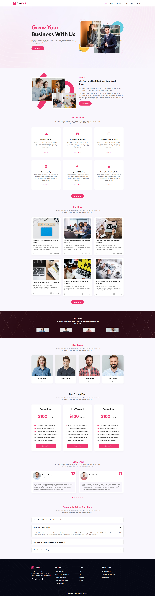
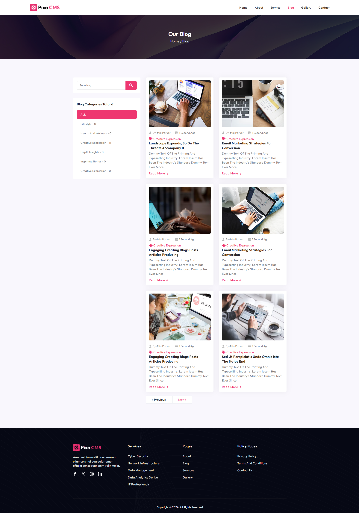
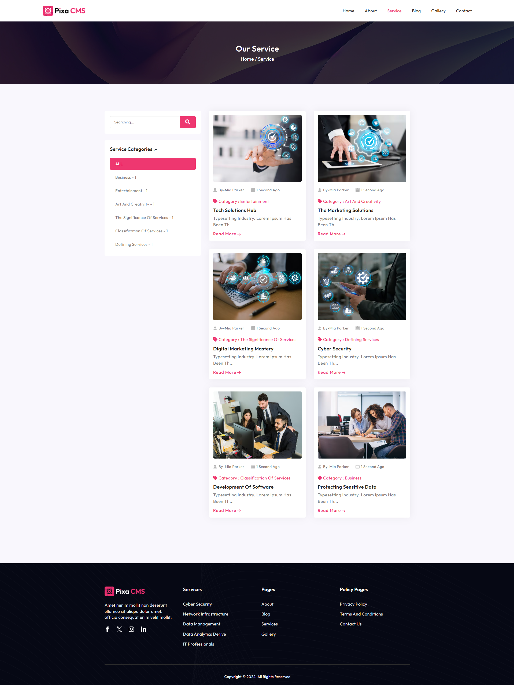
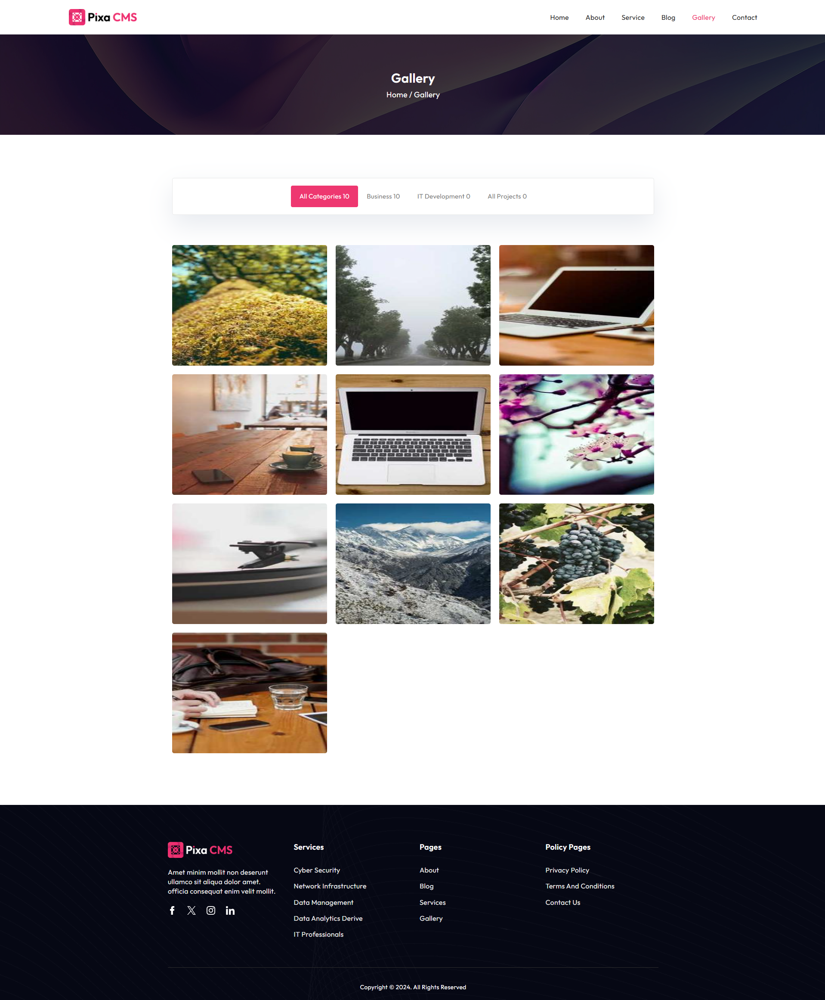
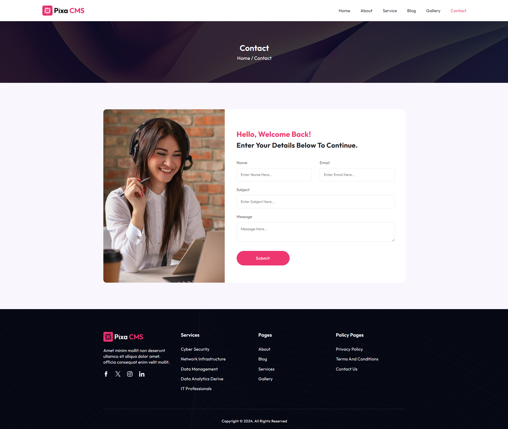

# Company Website CMS

A content management system built with **Laravel 10** for running a company website. It has an admin dashboard for managing the site's pages and content, and a public front end.


## Screenshots

| Home | Blog |
|---|---|
|  |  |

| Services | Gallery |
|---|---|
|  |  |

| Contact |
|---|
|  |

## Features

- Admin dashboard
- Category and blog management
- Service management
- Gallery management
- Testimonials
- Pricing plans
- FAQ management
- Team management
- Site settings, including changing the website's colors

## Libraries used

Font Awesome, Bootstrap Icons, ColorPicker, Dropify (image upload), Select2, SweetAlert2, Toastr, DataTables

## Getting started

### Requirements

- PHP and Composer
- Node.js and npm (or Yarn)
- MySQL

### Installation

```bash
git clone https://github.com/MohammedAbd20/cms-content-managment-system.git
cd cms-content-managment-system

composer install
npm install

cp .env.example .env
php artisan key:generate
```

Set your database credentials in `.env`, then run the migrations with demo data:

```bash
php artisan migrate:fresh --seed
php artisan serve
```

Open `http://127.0.0.1:8000`.

## Author

**Mohammed Abd Elrahman**: [GitHub](https://github.com/MohammedAbd20) · [LinkedIn](https://www.linkedin.com/in/mohammed-abd-elrahman-9618a732b/)
